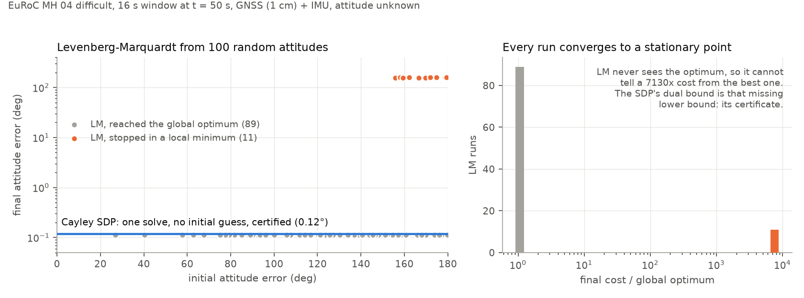
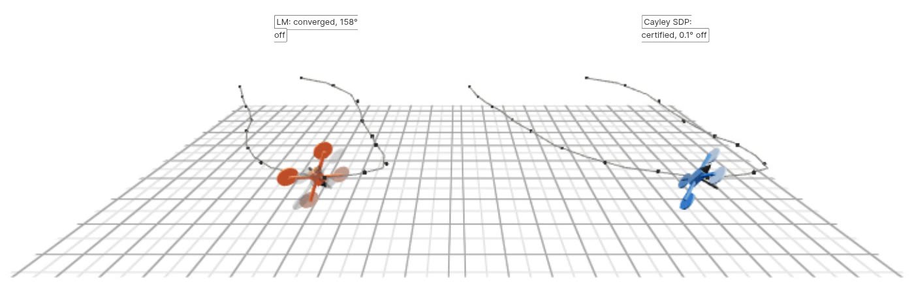
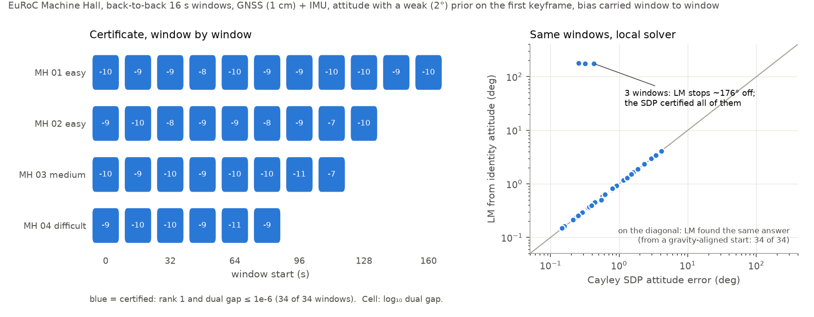
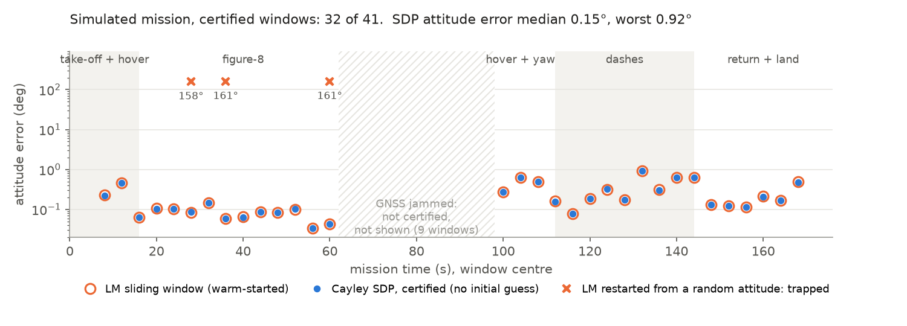
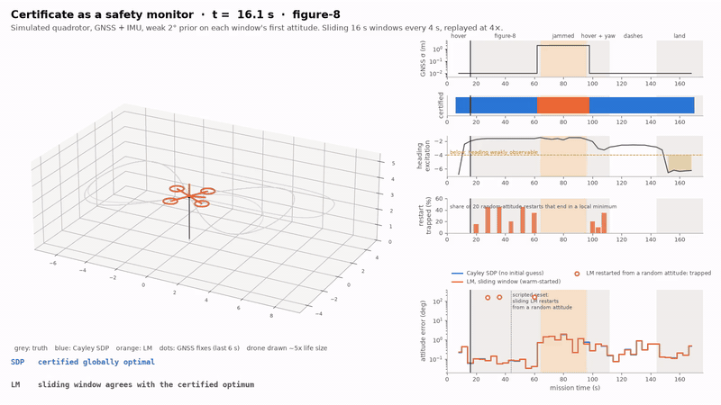

# A QCQP-Representable IMU Pre-Integration Factor for Certifiable State Estimation

[](https://arxiv.org/abs/2609.38048)
[](LICENSE)

Reference implementation and replication code for the paper.

> Utkarsh Rai, Zhexin Xu, Bang-Shien Chen, and David Rosen.
> *A QCQP-Representable IMU Pre-Integration Factor for Certifiable State Estimation.*
> arXiv:2609.38048, 2026.

Standard IMU pre-integration builds its bias correction out of the exponential map, which has no
exact polynomial form, so a pre-integrated inertial factor cannot be written as a QCQP and is
therefore out of reach of certifiable estimation. This code replaces `Exp` with the **Cayley
map**, which is a genuine retraction onto SO(3) *and* a ratio of polynomials: clearing its
denominator leaves a residual of degree two. A catalog of closed-form **redundant constraints**
on the resulting lifting variables then tightens the Shor relaxation to rank one, so the
estimate comes with a certificate of global optimality.

In practice that means GNSS–IMU smoothing that needs **no initial guess**, and that tells you,
per solve, whether the answer it returned is the global optimum.



*EuRoC MH_04_difficult, one 16 s window, attitude unknown. Levenberg–Marquardt on the standard
exp-map factor graph, started from 100 uniformly random attitudes, ends in a 158° mirror-image
local minimum 11 times out of 100, and nothing in its output distinguishes those runs from the
good ones. The Cayley SDP is solved once, without an initial guess, and certifies its answer
(dual gap 6e-10). Reproduce: `python demos/basins.py && python demos/plot_basins.py`.*

---

## Demos: the certified windows

Every demo poses the problem a GNSS–IMU system actually faces: GNSS velocity and position fixes
on every keyframe (simulated from ground truth with 1 cm/s and 1 cm of noise, or 2 m and
0.5 m/s while jammed) and raw IMU, with **no initial guess**. Levenberg–Marquardt on the standard exp-map
factor graph (GTSAM) sees the identical measurements.

A window counts as **certified** when the SDP solution has rank one *and* the estimate's cost is
within 1e-6 (relative) of the SDP's dual lower bound on the optimum (`r['eta_dual']`). That bound
is what makes the answer checkable: a certified window's estimate is provably the global optimum
of the problem as posed. **Everything below reports certified windows only.** Where a run also had
windows that did not certify, the count is given once and those windows are left out of every
statistic; in the figures they appear only as grey markers or a hatched gap.

| Demo | Data | Certified windows | SDP attitude error on them (median / worst) |
|---|---|---:|---:|
| 1. Trapped LM vs. one certified solve | EuRoC MH_04 | 1 / 1 | 0.1° |
| 2. Whole flights | EuRoC MH_01–MH_04 | **34 / 34** | 0.59° / 4.1° |
| 3. A safety-monitor mission | simulated quadrotor | 32 / 41 | 0.15° / 0.92° |
| 4. Two Hong Kong drives | UrbanNav | 122 / 143 | 0.45° / 1.5° (medium), 0.79° / 6.3° (deep) |

### 1. Local solvers get trapped; the certificate does not — `demos/basins.py`

The figure at the top. From a random start, LM converges either to the global optimum or to a
mirror solution about 158° away whose cost is ~7000× higher. Both are stationary points, so LM's
own convergence test cannot tell them apart; only a lower bound on the optimal cost can, and the
SDP's dual solution is exactly that lower bound. This window withholds attitude entirely
(`gauge_fix=False`), and the SDP certifies with a dual gap of 6e-10.

| Same path, wrong drone | Basin of attraction |
|---|---|
|  |  |
| The certified window in 3D. Both estimates fly the ground-truth track, because GNSS pins position to a centimetre either way; only the attitude differs. Left: LM converged 158° off. Right: the SDP, certified, 0.1° off. | 2,000 LM runs from random attitudes, each a point in the rotation-vector ball (radius π) descending to where it converges. Blue runs reach the certified optimum; orange runs end on the mirror minimum. |

### 2. Certified smoothing over whole flights — `demos/sequence_sweep.py`

Back-to-back 16 s windows over four EuRoC flights, with the bias carried from window to window
and a weak prior on the first keyframe's attitude (`gauge_fix='R_prior'`, σ = 0.05 per
rotation-matrix entry, about 2°). The prior enters the cost as a penalty ‖R₀ − R̄₀‖²_F / σ², not
as a constraint; LM gets the matching rotation prior. **Every window certifies.**



| sequence | windows certified | attitude err. SDP (median / max) | LM, gravity-aligned start: same optimum | LM, identity start: same optimum |
|---|---:|---:|---:|---:|
| MH\_01\_easy | 11 / 11 | 0.56° / 3.15° | 11 / 11 | 11 / 11 |
| MH\_02\_easy | 9 / 9 | 0.79° / 4.14° | 9 / 9 | 8 / 9 |
| MH\_03\_medium | 8 / 8 | 0.67° / 1.88° | 8 / 8 | 8 / 8 |
| MH\_04\_difficult | 6 / 6 | 0.52° / 1.51° | 6 / 6 | 4 / 6 |
| **all** | **34 / 34** | 0.59° / 4.14° | 34 / 34 | 31 / 34 |

- **Tight everywhere:** rank one, MOSEK status Optimal, worst dual gap 5e-7.
- **The certificate tells you when the local solver was right.** From the standard
  gravity-aligned start, LM finds the certified optimum on all 34 windows (to within 0.05°).
  Started from the identity attitude instead (the "LM from GNSS" initialisation of the paper's
  Fig. 1), it converges 176–177° away on 3 windows (MH_02 at 96 s, MH_04 at 48 s and 80 s). Those
  three windows are certified, so the trapped answers are exposed immediately: their cost sits
  above the certified lower bound.
- **Optimal is not the same as accurate.** The 0.59° median (4.1° worst) attitude error is the
  error of the certified optimum itself, almost all of it heading: with GNSS and IMU only, heading
  is observed through lateral acceleration, and some windows have little.
- **Online bias handling.** Only the first window of each flight is linearised at the dataset's
  bias; every later one starts from the previous window's estimate. The estimate stays within
  0.002–0.08 of the truth over every flight, with no drift.
- An SDP solve took a median of 20 s here with four sequences sharing 12 cores (6.7 s
  uncontended, see **Problem size**).

### 3. A certificate as a safety monitor — `demos/sim_mission.py`

A simulated quadrotor (`demos/sim_quad.py`, EuRoC IMU noise) flies a three-minute mission: take-off
and hover, figure-8s, a stretch with GNSS jammed to 2 m / 0.5 m/s, a hover with slow yaw, zig-zag
dashes, and a landing. It is estimated in sliding 16 s windows every 4 s, with the same weak 2°
attitude prior as demo 2. The SDP solves each window from scratch. LM runs the way a
sliding-window smoother runs it, warm-started from its own previous answer, with a scripted
estimator reset from a random attitude at 44 s.





*The figure-8 stretch, replayed at 4×. Left: the drone with truth (grey), the certified SDP
attitude (blue) and LM (orange). Right: the mission timelines with a moving cursor. The full
video is `demos/figures/mission.mp4`.*

- **32 of the 41 windows certify**, every one outside the jammed stretch, with dual gaps of at
  most 4e-9. On them the SDP attitude error has a median of 0.15° and a worst case of 0.92°. The 9
  jammed windows do not certify (2 m GNSS leaves the relaxation loose) and are left out.
- **The warm-started smoother agrees with the certificate.** On all 32 certified windows LM's
  sliding-window estimate is within 0.03° of the certified optimum, including after the reset.
- **Trapped restarts are caught.** Restarting LM from a random attitude on a certified window ends
  in a mirror minimum 8% of the time averaged over these windows (45% on the worst three). The
  fixed draw used in the figure is trapped on three windows (t = 20, 28 and 52 s), 158–161° off.
  All three are certified windows, so each trapped answer is rejected the moment it is compared
  against the certified bound.
- **Hover certifies, and the monitor still says why.** Take-off and the landing hover have no
  horizontal acceleration, so the data say nothing about heading. With the attitude prior these
  six windows certify within 0.5°, and the heading-excitation flag (`r['wahba_sv']`, log₁₀ σ₂/σ₁
  below −4) marks them as windows whose yaw rests on the prior rather than on the measurements.

### 4. Two Hong Kong drives — `demos/urbannav_map.py`

UrbanNav medium-urban (Tsim Sha Tsui) and deep-urban (Whampoa): a car with a consumer IMU, 39
minutes in 143 back-to-back 16 s windows. GNSS is simulated from ground truth as above, and here
the estimator gets **no attitude information at all** (`gauge_fix=False`).


- **122 of 143 windows certify**, with dual gaps of at most 4e-7. The 21 that do not are all the car at a stop (mean speed
  0 m/s), drawn as grey dots and left out.
- **Accuracy of the certified optimum:** attitude error median 0.45° (worst 1.5°) in medium-urban
  and 0.79° (worst 6.3°) in deep-urban.
- **The flag explains the outliers.** The three worst certified windows in deep-urban (3.5–6.3°)
  are the ones the heading-excitation flag marks as weakly observable (dotted in the figure).
  Every other certified window is within 2.8°.
- **LM agrees on every certified window.** From both the gravity-aligned and the identity start,
  LM reaches the certified optimal cost on all 122.

### Reproducing the demos

```bash
python demos/basins.py && python demos/plot_basins.py            # demo 1 (top figure)
for s in MH_01_easy MH_02_easy MH_03_medium MH_04_difficult; do
  python demos/sequence_sweep.py --seq $s &                      # demo 2
done; wait; python demos/plot_sweep.py
python demos/sim_quad.py && python demos/sim_mission.py          # demo 3, ~25 min
python demos/render_mission.py                                   #   -> demos/figures/mission.mp4
python demos/urbannav_map.py --workers 5                         # demo 4, ~40 min
python demos/plot_certified.py                                   # demos 3 and 4 figures
```

The JSON behind every figure is in `demos/out/`, so the `plot_*.py` scripts and
`render_mission.py` run without the datasets or MOSEK. The 3D still and the basin animation come
from Viser recordings (`demos/basin_ball.py` → `demos/web/make_replay.py`, `make_ball.py`,
`render_ball_clip.py`); those need `viser==0.2.23` and `trimesh`, which a separate small venv
can hold: `uv venv .venv-web && uv pip install -p .venv-web viser==0.2.23 trimesh`.
`sim_quad.py` writes its mission in EuRoC format (`data/sim/quad_mission/mav0`), so `run_euroc`
and the LM baseline run on it unchanged. Interactive versions of the 3D scenes and the UrbanNav
map are on the [project page](https://ur10.github.io/projects/certifiable-imu/).

---

## Requirements

```bash
python3 -m venv .venv && .venv/bin/pip install -r requirements.txt
```

Tested with Python 3.13 / NumPy 2.5 / gtsam 4.3.0, and with the paper's original Python 3.9 /
NumPy 1.23 / gtsam 4.2 (MOSEK 11.2 in both). **gtsam must match NumPy's major version**: the gtsam
4.2.x wheels segfault under NumPy 2 in `PreintegrationParams.setGyroscopeCovariance`, which every
synthetic run and the GTSAM baseline call (the real-data SDP runs don't, so a mismatched env looks
fine until then). See `requirements.txt`.

**MOSEK needs a licence.** It is the solver behind every result here. Academic licences are free
(<https://www.mosek.com/license/request/>); place the licence file at `~/mosek/mosek.lic`. Nothing
in this repository will run without it.

## Datasets

EuRoC and UrbanNav are not vendored. Download them and point environment variables at your
copies:

```bash
export EUROC_MH01=/path/to/MH_01_easy/mav0      # the directory containing imu0/ and state_groundtruth_estimate0/
export EUROC_ROOT=/path/to/euroc                # for demos/: holds MH_01_easy/mav0, MH_02_easy/mav0, ...
export URBANNAV_ROOT=/path/to/urbannav
```

- **EuRoC Machine Hall** — <https://projects.asl.ethz.ch/datasets/doku.php?id=kmavvisualinertialdatasets>
  (IMU at 200 Hz, ground truth at 200 Hz). The paper uses MH_01; the demos use MH_01–MH_04 and
  need only `imu0/` and `state_groundtruth_estimate0/` from each.
- **UrbanNav**, medium-urban and deep-urban — <https://github.com/IPNL-POLYU/UrbanNavDataset>
  (IMU resampled to ~400 Hz; see `urbannav_data.py` for the frame conventions, which were
  established empirically rather than from the dataset documentation)

Paths resolve through `datasets.py`, which fails with an actionable message rather than a stack
trace if a dataset is missing. The synthetic experiments need no dataset.

---

## Reproducing the paper

| Paper item | Command | Needs | Runtime |
|---|---|---|---|
| **Fig. 1** — local vs. certifiable solution | `python3 traj_178.py --gauge free` then `python3 teaser_3dinset.py` | EuRoC | ~1 min |
| **Fig. 3** — what each redundant subset buys | `python3 cayley_ablation_plots.py --gauge free` then `python3 ablation_figs.py` | — (synthetic) | ~30 min |
| **Table II** — real-world benchmarks | `python3 cayley_uniform_experiments.py multibias` | EuRoC + UrbanNav | ~30 min |
| **Table III** — vs. standard pre-integration | `python3 compare_gtsam_cayley.py matched` | EuRoC + UrbanNav | ~15 min |

Fig. 2 (the factor graph) and Table I (the constraint catalog) are drawn in LaTeX and have no
code behind them.

Each script writes its JSON next to itself and the plotting scripts read it from there. Three sets
of outputs ship with the repository:

| Directory | What produced it |
|---|---|
| `results/` | the paper's runs (free gauge, legacy solver) |
| `runs/free_gauge_cw/` | Fig. 1 and Fig. 3 re-run in the paper's free gauge with the current solver |
| `runs/centre_whiten/` | every paper script re-run with the current defaults (`gauge_fix='R'`) |

See **Changes since the paper** for why the latter two differ from the first.

### Start here if you have no datasets or no patience

```bash
cp results/ablation_svr.json . && python3 ablation_figs.py
```

This redraws Fig. 3 from the shipped data in a few seconds, and is the quickest check that the
environment is set up. The regenerated `ablation.png` is byte-identical to the figure in the
paper.

### A single window, end to end

```python
import numpy as np, sdp_preintegration_cayley as C, datasets
r = C.run_euroc(datasets.euroc(), T=16.0, kf_interval=1.0, t_start=6.0,
                weight_mode='dataset_cov', iso_reduce='mean',
                prior_sigmas=(1e-2, 1e-2, 1e-3, 1e-3), gauge_fix='R',
                add_redundant=True, kf_per_bias=8, accept_any=True)
print(r['rank'], r['eta'], r['eta_dual'], np.mean(r['rot_err']))   # rank 1 => certified
```

Those keyword arguments are the paper's nominal configuration. `run_synthetic` and
`run_urbannav` take the same ones. Add `gnss_seed=0` to corrupt the GNSS fixes with noise of the
stated sigmas instead of using ground truth, and `gauge_fix=False` to withhold all attitude
information, as the demos do.


## Citation

```bibtex
@article{rai2026cayley,
  title   = {A {QCQP}-Representable {IMU} Pre-Integration Factor for Certifiable State Estimation},
  author  = {Rai, Utkarsh and Xu, Zhexin and Chen, Bang-Shien and Rosen, David},
  journal = {arXiv preprint arXiv:2609.38048},
  year    = {2026}
}
```

## License

MIT — see [LICENSE](LICENSE).

Robust Autonomy Lab, Institute for Experiential Robotics, Northeastern University.
