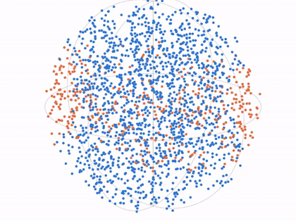
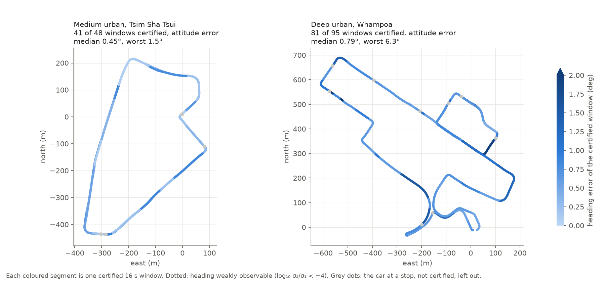

# A QCQP-Representable IMU Pre-Integration Factor for Certifiable State Estimation

**Inertial navigation with a checkable global-optimality certificate.**

[](https://arxiv.org/abs/2609.38048)
[](LICENSE)

**Utkarsh Rai · Zhexin Xu · Bang-Shien Chen · David Rosen**  
Robust Autonomy Lab · Institute for Experiential Robotics · Northeastern University

[**Paper**](https://arxiv.org/abs/2609.38048) · [**Interactive demos**](#interactive-demos) · [**Method**](#method) · [**Results**](#experimental-results) · [**Quick start**](#quick-start) · [**Reproduce the paper**](#reproducing-the-paper)

## Can we verify an inertial navigation estimate?

An inertial smoother can converge to a stationary point without establishing whether it has found the best explanation of its measurements. This matters when attitude initialization is poor: a plausible position trajectory can conceal a severely incorrect orientation.

We develop a **Cayley-based IMU preintegration factor that admits a quadratically constrained quadratic program (QCQP)**. Together with redundant constraints on its lifting variables, this enables a semidefinite relaxation that can recover and certify globally optimal solutions of the formulated estimation problem when the relaxation is tight.

This repository contains the reference implementation, paper-reproduction scripts, and extended GNSS–IMU smoothing experiments. The central question is both computational and diagnostic: **can we recover a solution without a user-supplied trajectory initialization, and verify its optimality afterward?**


*One 16 s EuRoC MH_04_difficult window with no attitude prior. Standard exponential-map LM converges to an approximately 158° attitude-error solution in 11 of 100 random-attitude initializations. A single Cayley SDP solve returns a 0.1° attitude-error estimate with a reported relative dual gap of 6 × 10⁻¹⁰. These methods use the same measurements but different inertial formulations; the certificate applies to the Cayley objective.*

## Research contributions

- **An algebraic inertial factor.** Replace exponential-map operations in the preintegration formulation with the rational Cayley map, enabling a QCQP representation with auxiliary variables for coupled state and bias terms.
- **A strengthened convex relaxation.** Add redundant algebraic constraints on the lifting variables to improve tightness of the Shor SDP relaxation. The constraints preserve feasible physical solutions while restricting the relaxed feasible set.
- **Verification alongside estimation.** Recover a candidate state and compare its objective value with an SDP dual lower bound. Report certification separately from estimation error and heading observability.
- **Evaluation across flight and driving sequences.** Study initialization sensitivity, relaxation tightness, bias propagation, and weakly excited motion using recorded EuRoC and UrbanNav IMU data, supplemented by a simulated quadrotor mission.

## Method


**Why change the preintegration factor?** The exponential map in the conventional formulation is an obstacle to an exact polynomial representation. The Cayley map is rational, allowing algebraic relations to be constructed and lifted into quadratic form. This is a reformulation of the inertial model; it is not a certificate for an unchanged exponential-map objective.

**Why add redundant constraints?** Introducing auxiliary variables makes the formulation quadratic, but dropping the rank constraint can separate those variables from the physical relationships they represent. Redundant identities restore some of this structure in the relaxation. Tightness is checked on each instance rather than assumed universally.

For the lifted variable vector $x$, the QCQP and its Shor relaxation have the form

$$
\begin{aligned}
\min_x\quad &x^\top Qx
&\longrightarrow\quad \min_{Z\succeq0}\quad &\langle Q,Z\rangle\\
\text{s.t.}\quad &x^\top A_i x=b_i
&\text{s.t.}\quad &\langle A_i,Z\rangle=b_i.
\end{aligned}
$$

The relaxation replaces $xx^\top$ by $Z$ and drops the rank-one requirement. For a feasible recovered estimate $\hat{x}$ and a valid dual bound $d$, weak duality gives

$$
d\;\leq\;f^\star_{\mathrm{QCQP}}\;\leq\;f(\hat{x}).
$$

A small gap between the endpoints bounds the estimate's suboptimality for this QCQP.

### What the certificate means

The demos classify a window as certified when the solution is numerically rank one and the relative candidate-to-dual gap (`eta_dual`) is at most $10^{-6}$. Feasibility and solver residuals must also be consistent with the numerical tolerances; rank alone is insufficient.

- **Certification concerns the stated objective**, including its noise model, bias linearization, and priors. It does not imply agreement with ground truth.
- **A non-certified window is inconclusive.** It is not automatically a failed estimate or proof of a local minimum.
- **Poor observability can persist at a global optimum.** Weak heading excitation can yield inaccurate yaw even when the optimization is certified.
- **Comparisons must use a common objective.** An exponential-map LM cost cannot be compared directly with a Cayley dual bound to certify or reject it. A baseline estimate must first be evaluated as a feasible candidate under the same QCQP and lifting constraints.

## Experimental results

The following results are from the extended repository demos. Paper-reproduction outputs are listed separately below.

**Measurement protocol.** Recorded-data experiments use real IMU measurements and **GNSS position and velocity fixes simulated from ground truth** at each keyframe. Nominal standard deviations are 1 cm in position and 1 cm/s in velocity. The simulated degraded-GNSS interval uses 2 m and 0.5 m/s. These experiments isolate optimization and observability behavior; they are not evaluations of raw urban GNSS multipath or an actual jamming model.

**Reporting protocol.** Certification counts include all windows. Attitude-error statistics below are conditional on certification; non-certified windows are excluded from those accuracy statistics and displayed as grey markers or hatched gaps in the figures.

| Experiment | Certified / total windows | Attitude error on certified windows, median / worst | Main finding |
|---|---:|---:|---|
| Initialization sensitivity · EuRoC MH_04 | 1 / 1 | 0.1° / 0.1° | Poor attitude starts can trap local optimization |
| Four EuRoC flights · MH_01–MH_04 | 34 / 34 | 0.59° / 4.14° | Certification across the tested flight windows |
| Simulated quadrotor mission | 32 / 41 | 0.15° / 0.92° | Degraded GNSS can prevent certification |
| UrbanNav · medium + deep urban | 122 / 143 | Medium: 0.45° / 1.5°; deep: 0.79° / 6.3° | Optimality and heading observability are distinct |

### 1. Initialization sensitivity: similar positions, different attitudes

GNSS strongly constrains position in the initialization experiment, so an incorrect orientation need not produce an obviously incorrect path. The 3D replay makes this ambiguity visible; the rotation-space animation shows the local optimizer's dependence on its starting attitude.

| Trajectory and attitude replay | Attitude-initialization study |
|---|---|
|  |  |

*The teaser reports 100 starts; the animation visualizes a separate 2,000-run study. Each point in the animation represents one LM run, not a robot or an SDP iteration.*

### 2. Flight sequences: verification can confirm a good local solution


All 34 flight windows certify. Gravity-aligned LM agrees closely with the certified estimate on all 34, while identity-initialized LM produces large attitude discrepancies on three. This demonstrates why verification is useful even when a well-initialized local solver usually succeeds.

These runs use a weak first-keyframe attitude prior and propagate the bias estimate between windows. They do not represent estimation without prior information.

### 3. Degraded measurements and weak excitation reveal different limitations


The simulated mission certifies 32 of 41 windows; the nine degraded-GNSS windows remain uncertified. During hover, an attitude prior can support a certified solution even when the measurements provide little heading information. The heading-excitation diagnostic distinguishes these conditions.



The UrbanNav runs certify 122 of 143 windows without an attitude prior. The remaining 21 occur while the vehicle is stopped. The largest certified heading errors occur in weakly excited motion, illustrating that **solving the optimization problem globally does not remove ambiguity in the measurements**.

<details>
<summary><strong>Detailed protocols, per-sequence results, and additional visualizations</strong></summary>

### Flight protocol and per-sequence breakdown — `demos/sequence_sweep.py`

Back-to-back 16 s windows over four EuRoC flights, with the bias carried from window to window
and a weak prior on the first keyframe's attitude (`gauge_fix='R_prior'`, σ = 0.05 per
rotation-matrix entry, about 2°). The prior enters the cost as a penalty ‖R₀ − R̄₀‖²_F / σ², not
as a constraint; LM gets the matching rotation prior. **Every window certifies.**


| sequence | windows certified | attitude err. SDP (median / max) | LM, gravity-aligned: attitude agreement | LM, identity: attitude agreement |
|---|---:|---:|---:|---:|
| MH\_01\_easy | 11 / 11 | 0.56° / 3.15° | 11 / 11 | 11 / 11 |
| MH\_02\_easy | 9 / 9 | 0.79° / 4.14° | 9 / 9 | 8 / 9 |
| MH\_03\_medium | 8 / 8 | 0.67° / 1.88° | 8 / 8 | 8 / 8 |
| MH\_04\_difficult | 6 / 6 | 0.52° / 1.51° | 6 / 6 | 4 / 6 |
| **all** | **34 / 34** | 0.59° / 4.14° | 34 / 34 | 31 / 34 |

- **Tight everywhere:** rank one, MOSEK status Optimal, worst dual gap 5e-7.
- **The certificate tells you when the local solver was right.** From the standard
  gravity-aligned start, LM agrees with the certified attitude on all 34 windows (to within 0.05°).
  Started from the identity attitude instead (the "LM from GNSS" initialisation of the paper's
  Fig. 1), it converges 176–177° away on 3 windows (MH_02 at 96 s, MH_04 at 48 s and 80 s). Those
  three windows are certified, providing a verified reference for the Cayley problem. A formal cost-based comparison
  requires evaluating each baseline estimate under that same objective.
- **Optimal is not the same as accurate.** The 0.59° median (4.1° worst) attitude error is the
  error of the certified optimum itself, almost all of it heading: with GNSS and IMU only, heading
  is observed through lateral acceleration, and some windows have little.
- **Online bias handling.** Only the first window of each flight is linearised at the dataset's
  bias; every later one starts from the previous window's estimate. Bias is propagated between windows rather than repeatedly initialized from ground truth.
- The reported median solve time is 20 s with four sequences sharing 12 cores,
  versus 6.7 s in an uncontended run. These are configuration-dependent reference timings.

### Simulated mission and optimality monitoring — `demos/sim_mission.py`

A simulated quadrotor (`demos/sim_quad.py`, EuRoC IMU noise) flies a three-minute mission: take-off
and hover, figure-8s, a stretch with GNSS noise increased to 2 m / 0.5 m/s, a hover with slow yaw, zig-zag
dashes, and a landing. It is estimated in sliding 16 s windows every 4 s, with the same weak 2°
attitude prior as the flight sweep. The SDP solves each window from scratch. LM runs the way a
sliding-window smoother runs it, warm-started from its own previous answer, with a scripted
estimator reset from a random attitude at 44 s.


*The figure-8 stretch, replayed at 4×. Left: the drone with truth (grey), the certified SDP
attitude (blue) and LM (orange). Right: the mission timelines with a moving cursor. The full
video is `demos/figures/mission.mp4`.*

- **32 of the 41 windows certify**, every one outside the degraded-GNSS stretch, with dual gaps of at
  most 4e-9. On them the SDP attitude error has a median of 0.15° and a worst case of 0.92°. The 9
  degraded-GNSS windows do not certify (2 m GNSS leaves the relaxation loose) and are left out.
- **The warm-started smoother agrees closely with the certified estimate.** On all 32 certified windows LM's
  sliding-window estimate is within 0.03° of the certified optimum, including after the reset.
- **Random restarts expose additional local-solver failures.** Restarting LM from a random attitude on a certified window ends
  in a mirror minimum 8% of the time averaged over these windows (45% on the worst three). The
  fixed draw used in the figure is trapped on three windows (t = 20, 28 and 52 s), 158–161° off.
  All three have a certified Cayley reference. Certifying or rejecting the LM candidates
  themselves requires feasibility and cost evaluation under the same Cayley QCQP.
- **Hover certifies, and the monitor still says why.** Take-off and the landing hover have no
  horizontal acceleration, so the data say nothing about heading. With the attitude prior these
  six windows certify within 0.5°, and the heading-excitation flag (`r['wahba_sv']`, log₁₀ σ₂/σ₁
  below −4) marks them as windows whose yaw rests on the prior rather than on the measurements.

### UrbanNav driving protocol — `demos/urbannav_map.py`

UrbanNav medium-urban (Tsim Sha Tsui) and deep-urban (Whampoa): a car with a consumer IMU, 39
minutes in 143 back-to-back 16 s windows. GNSS is simulated from ground truth as above, and here
the estimator uses **no attitude prior** (`gauge_fix=False`).


- **122 of 143 windows certify**, with dual gaps of at most 4e-7. The 21 that do not are all the car at a stop (mean speed
  0 m/s), drawn as grey dots and left out.
- **Accuracy of the certified optimum:** attitude error median 0.45° (worst 1.5°) in medium-urban
  and 0.79° (worst 6.3°) in deep-urban.
- **The flag explains the outliers.** The three worst certified windows in deep-urban (3.5–6.3°)
  are the ones the heading-excitation flag marks as weakly observable (dotted in the figure).
  Every other certified window is within 2.8°.
- **LM agrees on every certified window.** From both the gravity-aligned and the identity start,
  the supplied experiments report agreement with the certified solution on all 122.
  Cross-formulation cost agreement should not be interpreted as a certificate for the exponential-map objective.


</details>

## Interactive demos

Everything below runs from files in this repository; nothing is hosted elsewhere.

| Demo | Open it | What you see |
|---|---|---|
| **Two Hong Kong drives on a map** | [Medium urban, Tsim Sha Tsui](demos/figures/urbannav_medium.geojson) · [Deep urban, Whampoa](demos/figures/urbannav_deep.geojson) | GitHub renders these GeoJSON files as zoomable street maps. Each certified 16 s window is a segment coloured by heading error (light blue 0°, dark blue ≥ 2°); thin translucent segments are weakly observable heading; grey markers are the car at a stop (not certified). Click any feature for its certificate, dual gap, excitation and errors. |
| **The full mission video** | [`demos/figures/mission.mp4`](demos/figures/mission.mp4) (1.5 MB) | The whole three-minute simulated mission replayed at 4×, with the certificate, heading-excitation flag, restart risk and both estimators' attitude error on moving timelines. The GIF in the detailed results is its figure-8 stretch. |
| **Same path, wrong drone** (3D) | run locally, below | The certified MH_04 window in 3D: LM's trapped attitude (158° off) next to the certified SDP attitude (0.1° off), both flying the ground-truth track. Orbit, zoom and scrub the 16 s timeline. |
| **Basin of attraction** (3D) | run locally, below | 2,000 LM runs from random attitudes, each a point in the rotation-vector ball, descending to where it converges: blue to the certified optimum, orange to the mirror minimum. |

The two 3D scenes are [Viser](https://viser.studio) recordings played in Viser's web viewer. They
need neither MOSEK nor the datasets:

```bash
uv venv .venv-web && uv pip install -p .venv-web viser==0.2.23 trimesh
.venv-web/bin/python demos/web/serve_replays.py      # prints one localhost link per scene
```

The script builds both recordings from `demos/out/` on first use, serves them at
`http://localhost:8000`, and prints the two links to open.


## Quick start

### Install the environment

```bash
python3 -m venv .venv
source .venv/bin/activate
python -m pip install -r requirements.txt
```

The supplied implementation reports testing with Python 3.13 / NumPy 2.5 / GTSAM 4.3.0 and with the original Python 3.9 / NumPy 1.23 / GTSAM 4.2 environment, using MOSEK 11.2. Follow `requirements.txt` for compatible versions. GTSAM 4.2.x wheels are reported to crash with NumPy 2 when setting the gyroscope covariance; a real-data SDP run alone may not expose this mismatch.

**Running SDP solves requires a MOSEK license.** [Academic licenses](https://www.mosek.com/license/request/) are available; place the license at `~/mosek/mosek.lic`. Plotting the supplied results does not require solving a new SDP or downloading datasets.

### Inspect a result without rerunning optimization

```bash
cp results/ablation_svr.json .
python ablation_figs.py
```

This regenerates `ablation.png` from the supplied paper results. It is the shortest route to inspecting the redundant-constraint ablation. Demo plotting and rendering scripts similarly use the JSON in `demos/out/`.

### Solve a single window

After configuring the EuRoC paths below:

```python
import numpy as np
import sdp_preintegration_cayley as C
import datasets

r = C.run_euroc(
    datasets.euroc(), T=16.0, kf_interval=1.0, t_start=6.0,
    weight_mode='dataset_cov', iso_reduce='mean',
    prior_sigmas=(1e-2, 1e-2, 1e-3, 1e-3), gauge_fix='R',
    add_redundant=True, kf_per_bias=8, accept_any=True,
)
print('Numerical rank:', r['rank'])
print('Reported relaxation gap:', r['eta'])
print('Relative candidate-to-dual gap:', r['eta_dual'])
print('Mean reported rotation error:', np.mean(r['rot_err']))
# Inspect rank, dual gap, feasibility, and solver residuals together.
# Rank one alone is not a numerical optimality certificate.
```

This example uses `gauge_fix='R'`; it is not the no-attitude-information configuration. Use `gauge_fix=False` to withhold attitude information. Add `gnss_seed=0` to perturb ground-truth position and velocity with the configured noise rather than using unperturbed ground truth. `run_synthetic` and `run_urbannav` expose the corresponding entry points.

## Datasets

EuRoC and UrbanNav are not included. Configure paths after downloading:

```bash
export EUROC_MH01=/path/to/MH_01_easy/mav0
export EUROC_ROOT=/path/to/euroc
export URBANNAV_ROOT=/path/to/urbannav
```

- **[EuRoC Machine Hall](https://projects.asl.ethz.ch/datasets/doku.php?id=kmavvisualinertialdatasets):** the supplied experiments use 200 Hz IMU and ground truth. The paper uses MH_01; the flight demos use MH_01–MH_04. Each sequence needs `imu0/` and `state_groundtruth_estimate0/` beneath `mav0/`.
- **[UrbanNav](https://github.com/IPNL-POLYU/UrbanNavDataset):** medium-urban and deep-urban sequences, with IMU resampled to approximately 400 Hz. See `urbannav_data.py` for the empirically established frame conventions; check them when adapting the loader to other sequences.
- **Synthetic mission:** `demos/sim_quad.py` writes EuRoC-format data to `data/sim/quad_mission/mav0`, allowing the existing real-data entry points and baseline to process it.

`datasets.py` resolves dataset paths and reports missing inputs. Synthetic experiments require no external dataset.

## Reproducing the demos

```bash
python demos/basins.py && python demos/plot_basins.py            # initialization sensitivity (top figure)
for s in MH_01_easy MH_02_easy MH_03_medium MH_04_difficult; do
  python demos/sequence_sweep.py --seq $s &                      # flight sequences
done; wait; python demos/plot_sweep.py
python demos/sim_quad.py && python demos/sim_mission.py          # simulated mission, ~25 min
python demos/render_mission.py                                   #   -> demos/figures/mission.mp4
python demos/urbannav_map.py --workers 5                         # UrbanNav drives, ~40 min
python demos/plot_certified.py                                   # mission and UrbanNav figures
python demos/web/make_geojson.py                                 # UrbanNav GeoJSON maps
```

The JSON behind every figure is in `demos/out/`, so the `plot_*.py` scripts and
`render_mission.py` run without the datasets or MOSEK. The 3D still and the basin animation come
from Viser recordings (`demos/basin_ball.py` → `demos/web/make_replay.py`, `make_ball.py`,
`render_ball_clip.py`); those need `viser==0.2.23` and `trimesh`, which a separate small venv
can hold: `uv venv .venv-web && uv pip install -p .venv-web viser==0.2.23 trimesh`.
`sim_quad.py` writes its mission in EuRoC format (`data/sim/quad_mission/mav0`), so `run_euroc`
and the LM baseline run on it unchanged. To explore the 3D scenes and the UrbanNav map
interactively, see [Interactive demos](#interactive-demos).


## Reproducing the paper

| Paper item | Command | Needs | Runtime |
|---|---|---|---|
| **Fig. 1** — local vs. certifiable solution | `python3 traj_178.py --gauge free` then `python3 teaser_3dinset.py` | EuRoC | ~1 min |
| **Fig. 3** — what each redundant subset buys | `python3 cayley_ablation_plots.py --gauge free` then `python3 ablation_figs.py` | — (synthetic) | ~30 min |
| **Table II** — real-world benchmarks | `python3 cayley_uniform_experiments.py multibias` | EuRoC + UrbanNav | ~30 min |
| **Table III** — vs. standard pre-integration | `python3 compare_gtsam_cayley.py matched` | EuRoC + UrbanNav | ~15 min |

Fig. 2 (the factor graph) and Table I (the constraint catalog) are drawn in LaTeX and have no
code behind them.

Each script writes its JSON next to itself and the plotting scripts read it from there. Three sets
of outputs ship with the repository:

| Directory | What produced it |
|---|---|
| `results/` | the paper's runs (free gauge, legacy solver) |
| `runs/free_gauge_cw/` | Fig. 1 and Fig. 3 re-run in the paper's free gauge with the current solver |
| `runs/centre_whiten/` | every paper script re-run with the current defaults (`gauge_fix='R'`) |

**Compare like-for-like configurations.** The directories differ in solver version and attitude/gauge settings; a rerun with a fixed rotation is not the same estimation problem as a free-attitude run. Preserve those settings when comparing costs, tightness, or figures.

## Code guide

| Entry point | Purpose |
|---|---|
| `sdp_preintegration_cayley.py` | Cayley SDP solver and synthetic / real-data entry points |
| `datasets.py` | Dataset path resolution |
| `urbannav_data.py` | UrbanNav loading and coordinate conventions |
| `cayley_ablation_plots.py`, `ablation_figs.py` | Redundant-constraint ablations and figures |
| `cayley_uniform_experiments.py` | Paper benchmark runs |
| `compare_gtsam_cayley.py` | Comparison with standard preintegration |
| `demos/` | Initialization, flight, simulated-mission, and driving studies |
| `demos/out/` | Saved demo results for plotting and rendering |
| `demos/figures/` | README figures, animations, mission video, and UrbanNav GeoJSON maps |
| `demos/web/` | Viser 3D recordings, the local replay server, and the GeoJSON export |

## Citation

```bibtex
@article{rai2026cayley,
  title   = {A {QCQP}-Representable {IMU} Pre-Integration Factor for Certifiable State Estimation},
  author  = {Rai, Utkarsh and Xu, Zhexin and Chen, Bang-Shien and Rosen, David},
  journal = {arXiv preprint arXiv:2609.38048},
  year    = {2026}
}
```

## License

MIT — see [LICENSE](LICENSE).

Robust Autonomy Lab, Institute for Experiential Robotics, Northeastern University.
