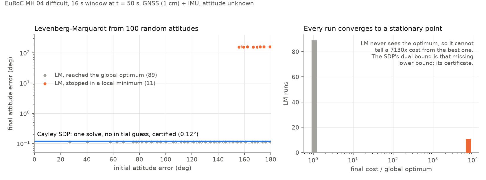
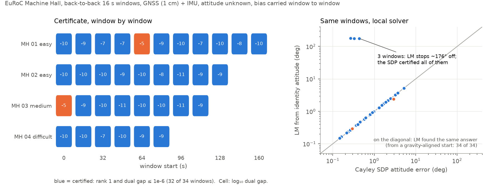

# A QCQP-Representable IMU Pre-Integration Factor for Certifiable State Estimation

[](https://arxiv.org/abs/2609.38048)
[](LICENSE)

Reference implementation and replication code for the paper.

> Utkarsh Rai, Zhexin Xu, Bang-Shien Chen, and David Rosen.
> *A QCQP-Representable IMU Pre-Integration Factor for Certifiable State Estimation.*
> arXiv:2609.38048, 2026.

Standard IMU pre-integration builds its bias correction out of the exponential map, which has no
exact polynomial form, so a pre-integrated inertial factor cannot be written as a QCQP and is
therefore out of reach of certifiable estimation. This code replaces `Exp` with the **Cayley
map**, which is a genuine retraction onto SO(3) *and* a ratio of polynomials: clearing its
denominator leaves a residual of degree two. A catalog of closed-form **redundant constraints**
on the resulting lifting variables then tightens the Shor relaxation to rank one, so the
estimate comes with a certificate of global optimality.

In practice that means GNSS–IMU smoothing that needs **no initial guess**, and that tells you,
per solve, whether the answer it returned is the global optimum.



*EuRoC MH_04_difficult, one 16 s window, attitude unknown. Levenberg–Marquardt on the standard
exp-map factor graph, started from 100 uniformly random attitudes, ends in a 158° mirror-image
local minimum 11 times out of 100, and nothing in its output distinguishes those runs from the
good ones. The Cayley SDP is solved once, without an initial guess, and certifies its answer
(dual gap 6e-10). Reproduce: `python demos/basins.py && python demos/plot_basins.py`.*

---

## Demos on EuRoC

Both demos pose the problem a GNSS–IMU system actually faces: GNSS velocity and position fixes on
every keyframe (simulated as ground truth plus 1 cm/s and 1 cm noise), raw IMU, and **no attitude
information at all**, neither as an anchor nor as an initial guess (`gauge_fix=False`). Both
estimators see the identical measurements. A window counts as certified when the SDP solution has
rank one *and* the estimate's cost is within 1e-6 (relative) of the SDP's dual lower bound on the
optimum, `r['eta_dual']`.

### 1. Local solvers get trapped; the certificate does not — `demos/basins.py`

The figure above. From a random start, LM converges either to the global optimum or to a mirror
solution about 158° away whose cost is ~7000× higher. Both are stationary points, so LM's own
convergence test cannot tell them apart; only a lower bound on the optimal cost can, and the
SDP's dual solution is exactly that lower bound.

### 2. Certified smoothing over whole flights — `demos/sequence_sweep.py`



| sequence | windows | certified | attitude err. SDP (median / max) | LM, gravity-aligned start: same optimum | LM, identity start: same optimum |
|---|---:|---:|---:|---:|---:|
| MH\_01\_easy | 11 | 10 | 0.57° / 3.65° | 11 / 11 | 11 / 11 |
| MH\_02\_easy | 9 | 9 | 0.82° / 5.24° | 9 / 9 | 8 / 9 |
| MH\_03\_medium | 8 | 7 | 1.06° / 2.91° | 8 / 8 | 8 / 8 |
| MH\_04\_difficult | 6 | 6 | 0.53° / 1.52° | 6 / 6 | 4 / 6 |
| **all** | 34 | 32 | 0.71° / 5.24° | 34 / 34 | 31 / 34 |

- **32 of 34 windows certify.** The two that do not are MH_03 at take-off (rank 3; the window
  with the least lateral motion of all 34) and MH_01 at 64 s (rank one, but MOSEK stopped with
  status Unknown at a dual gap of 1e-5).
- **The local solver is usually right, and the SDP says when.** From the standard
  gravity-aligned start, LM finds the same optimum on all 34 windows. Started from the identity
  attitude instead (the "LM from GNSS" initialisation of the paper's Fig. 1), it converges 176–177°
  away on 3 windows (MH_02 at 96 s, MH_04 at 48 s and 80 s), all three of which the SDP certified.
  Where LM succeeds the two estimates agree to within 0.07°; what the SDP adds is the proof.
- **Optimal is not the same as accurate.** The remaining 0.7° median (5.2° worst) attitude error
  is the error of the certified optimum itself, ~97% of it heading: with GNSS and IMU only,
  heading is observed through lateral acceleration, and some windows have little.
- **Online bias handling.** Only the first window of each flight is linearised at the dataset's
  bias; every later one starts from the previous window's estimate. The estimate stays within
  0.02–0.07 of the truth over every flight, with no drift.
- An SDP solve took a median of 47 s here with four sequences sharing 12 cores (6.7 s
  uncontended, see **Problem size**).

```bash
for s in MH_01_easy MH_02_easy MH_03_medium MH_04_difficult; do
  python demos/sequence_sweep.py --seq $s &      # 5-15 min per sequence; run in parallel
done; wait
python demos/plot_sweep.py
```

The JSON behind both figures is in `demos/out/`, so `plot_*.py` runs without the datasets.

---

## Requirements

```bash
python3 -m venv .venv && .venv/bin/pip install -r requirements.txt
```

Tested with Python 3.13 / NumPy 2.5 / gtsam 4.3.0, and with the paper's original Python 3.9 /
NumPy 1.23 / gtsam 4.2 (MOSEK 11.2 in both). **gtsam must match NumPy's major version**: the gtsam
4.2.x wheels segfault under NumPy 2 in `PreintegrationParams.setGyroscopeCovariance`, which every
synthetic run and the GTSAM baseline call (the real-data SDP runs don't, so a mismatched env looks
fine until then). See `requirements.txt`.

**MOSEK needs a licence.** It is the solver behind every result here. Academic licences are free
(<https://www.mosek.com/license/request/>); place the licence file at `~/mosek/mosek.lic`. Nothing
in this repository will run without it.

## Datasets

EuRoC and UrbanNav are not vendored. Download them and point environment variables at your
copies:

```bash
export EUROC_MH01=/path/to/MH_01_easy/mav0      # the directory containing imu0/ and state_groundtruth_estimate0/
export EUROC_ROOT=/path/to/euroc                # for demos/: holds MH_01_easy/mav0, MH_02_easy/mav0, ...
export URBANNAV_ROOT=/path/to/urbannav
```

- **EuRoC Machine Hall** — <https://projects.asl.ethz.ch/datasets/doku.php?id=kmavvisualinertialdatasets>
  (IMU at 200 Hz, ground truth at 200 Hz). The paper uses MH_01; the demos use MH_01–MH_04 and
  need only `imu0/` and `state_groundtruth_estimate0/` from each.
- **UrbanNav**, medium-urban and deep-urban — <https://github.com/IPNL-POLYU/UrbanNavDataset>
  (IMU resampled to ~400 Hz; see `urbannav_data.py` for the frame conventions, which were
  established empirically rather than from the dataset documentation)

Paths resolve through `datasets.py`, which fails with an actionable message rather than a stack
trace if a dataset is missing. The synthetic experiments need no dataset.

---

## Reproducing the paper

| Paper item | Command | Needs | Runtime |
|---|---|---|---|
| **Fig. 1** — local vs. certifiable solution | `python3 traj_178.py --gauge free` then `python3 teaser_3dinset.py` | EuRoC | ~1 min |
| **Fig. 3** — what each redundant subset buys | `python3 cayley_ablation_plots.py --gauge free` then `python3 ablation_figs.py` | — (synthetic) | ~30 min |
| **Table II** — real-world benchmarks | `python3 cayley_uniform_experiments.py multibias` | EuRoC + UrbanNav | ~30 min |
| **Table III** — vs. standard pre-integration | `python3 compare_gtsam_cayley.py matched` | EuRoC + UrbanNav | ~15 min |

Fig. 2 (the factor graph) and Table I (the constraint catalog) are drawn in LaTeX and have no
code behind them.

Each script writes its JSON next to itself and the plotting scripts read it from there. Three sets
of outputs ship with the repository:

| Directory | What produced it |
|---|---|
| `results/` | the paper's runs (free gauge, legacy solver) |
| `runs/free_gauge_cw/` | Fig. 1 and Fig. 3 re-run in the paper's free gauge with the current solver |
| `runs/centre_whiten/` | every paper script re-run with the current defaults (`gauge_fix='R'`) |

See **Changes since the paper** for why the latter two differ from the first.

### Start here if you have no datasets or no patience

```bash
cp results/ablation_svr.json . && python3 ablation_figs.py
```

This redraws Fig. 3 from the shipped data in a few seconds, and is the quickest check that the
environment is set up. The regenerated `ablation.png` is byte-identical to the figure in the
paper.

### A single window, end to end

```python
import numpy as np, sdp_preintegration_cayley as C, datasets
r = C.run_euroc(datasets.euroc(), T=16.0, kf_interval=1.0, t_start=6.0,
                weight_mode='dataset_cov', iso_reduce='mean',
                prior_sigmas=(1e-2, 1e-2, 1e-3, 1e-3), gauge_fix='R',
                add_redundant=True, kf_per_bias=8, accept_any=True)
print(r['rank'], r['eta'], r['eta_dual'], np.mean(r['rot_err']))   # rank 1 => certified
```

Those keyword arguments are the paper's nominal configuration. `run_synthetic` and
`run_urbannav` take the same ones. Add `gnss_seed=0` to corrupt the GNSS fixes with noise of the
stated sigmas instead of using ground truth, and `gauge_fix=False` to withhold all attitude
information, as the demos do.

---

## What the code does

| File | Role |
|---|---|
| `sdp_preintegration_cayley.py` | The implementation. Cayley pre-integration, the lifted QCQP, the redundant-constraint catalog, the conditioned SDP, and the `run_synthetic` / `run_euroc` / `run_urbannav` entry points. |
| `sdp_preintegration.py` | Synthetic scenarios (`sick`, `loop`) and pre-integration helpers, shared with the GTSAM baseline. |
| `urbannav_data.py` | UrbanNav loader: resampling, geodetic→ENU, frame conventions, static bias initialisation. |
| `gtsam_baseline.py` | The comparison point: the standard exp-map factor graph solved by Levenberg–Marquardt. |
| `datasets.py` | Dataset path resolution. |

Experiments:

| File | Produces |
|---|---|
| `cayley_ablation_plots.py` | `ablation_svr.json` — 840 synthetic solves (5 constraint stages × 7 noise levels × 12 seeds × 2 trajectories) |
| `ablation_figs.py` | `ablation.png` (Fig. 3), plus `ablation_rate.png` and `ablation_svr.png` |
| `cayley_uniform_experiments.py` | `uniform_*.json` — real-data tightness under one fixed configuration (Table II) |
| `compare_gtsam_cayley.py` | `matched.json`, `divergence.json` — head-to-head against LM (Table III) |
| `traj_178.py` / `teaser_3dinset.py` | `traj_teaser.json` → Fig. 1 |
| `cayley_progressive_tightening.py` | `progressive_tightening.json` — rank collapse as constraint families are added. Supplementary; needs no dataset. |
| `cayley_dual_certificate.py` | Explicit dual certificate, retaining the constraint multipliers |
| `demos/` | The two EuRoC demos above |
| `experiments/` | A/B studies behind the solver changes since the paper: conditioning, objective scaling, covariance isotropisation |

### Problem size

The SDP is `min ⟨Q,Z⟩  s.t. ⟨Aᵢ,Z⟩ = bᵢ, Z ⪰ 0`, with the PSD block of order

```
n = 15N + 6M + 24E + 1          N keyframes, M bias blocks, E = N−1 inertial edges
```

| keyframes | n | constraints | unknowns in Z | MOSEK |
|---:|---:|---:|---:|---:|
| 9 | 334 | 614 | 55 945 | 2.9 s |
| 17 | 652 | 1 206 | 212 878 | 6.7 s |
| 25 | 970 | 1 798 | 470 935 | 18.7 s |
| 50 | 1 969 | 3 648 | 1 939 465 | 169 s (1.7 GB) |

(EuRoC MH_01, `t_start = 6 s`, `kf_per_bias = 8`; rank 1 — certified — at every size.) The
lifting variables are the majority of the cone: 384 of 652 at 17 keyframes.

---

## Changes since the paper

- **Conditioned solver.** `solve_cayley_sdp` now defaults to `conditioning='centre_whiten'`: an
  exact congruence `Z = T Z_t Tᵀ` that centres every variable on an a-priori reference (the R₀
  anchor or prior, or, with no attitude information, `wahba_R0`, a closed-form alignment of the
  GNSS velocity/position increments with the IMU's pre-integrated ones) and whitens it. The
  relaxation, its rank and its optimum are unchanged; what changes is that `Q = BᵀB` no longer
  has to cancel ~1e9-sized entries down to an optimum of ~1, so MOSEK reaches η ≈ 1e-8 where the
  paper's scalar `obj_scale='auto'` left η up to 3e-3. Every result also carries `eta_dual`, the
  gap to the dual bound. `conditioning=None` restores the paper's formulation. Evidence:
  `experiments/cayley_conditioning.py`.
- **Gauge default `gauge_fix='R'`.** The paper (and `results/`) used the free gauge. `'R'`
  hard-anchors R₀, which removes the heading ambiguity on near-stationary windows (see below)
  and brings Table III rotation errors from 0.36–57.8° down to 0.08–1.04°. It also pins tilt,
  which gravity already observes, so it acts as an exact attitude measurement; pass
  `--gauge free` (as in the reproduction table) for the paper's setting. Under `'R'` the Fig. 1
  failure no longer occurs, because the anchor removes the ambiguity it relies on.
- **Fig. 3 in the free gauge** with the conditioned solver (`runs/free_gauge_cw/`): the full
  catalog certifies 168/168 (paper 167/168) with η ≤ 1.4e-7 (paper up to 1.5e-2). At σ ≤ 1e-3
  the stage-3 subset now reaches rank one on all 48 runs (paper 28), 38 of them with η ≤ 1e-6;
  at higher noise its counts barely move, so the paper's conclusion that the full catalog is
  needed stands. Fig. 1 reproduces (ours 0.67° at rank one, LM from GNSS 178.09° against the
  paper's 178.11°).
- **`weight_mode='mle'`** was rank-tight on 12 of 36 Table II windows in the paper's setting; with
  the current defaults it is 35 of 36. `'dataset_cov'` remains the recommended setting.
- `ablation_figs.py` had its `__main__` guard above `fig_ablation`, so running the script never
  drew the paper's figure. Fixed.

## Limitations

- **A certificate is not a guarantee of accuracy.** It certifies global optimality of the problem
  as posed. When a window barely accelerates sideways, heading is weakly observable and the
  optimum itself can sit degrees from the truth (demo 2, right panel); on stationary UrbanNav
  windows (medium@40 s, deep@90 s) the free gauge certifies at rank one with 72–82° of pure
  heading error. `r['wahba_sv']` exposes the excitation, and a window whose second singular value
  is tiny relative to the first should not be trusted for heading, certified or not.
- **The bias prior must be informative.** Tightness relies on the bias being pinned near its
  linearisation point, as it is by the paper's random-walk prior (σ_bg ≈ 8e-5 rad/s, σ_ba ≈ 1e-2
  m/s² over 16 s). With a broad prior (0.05 rad/s, 0.3 m/s²) the relaxation is not tight (rank
  > 100) even when linearised at the true bias; a calibration-grade prior (1e-3, 3e-2) certified
  one of two EuRoC windows tested. In a running system this is the regime of carrying the bias
  from the previous window, which demo 2 does.
- **Table II.** `results/uniform_multibias.json` does not reproduce the paper's Table II to the
  digit (EuRoC K = 16, M = 2: median η 1.5e-6 against the paper's 2.9e-6); the qualitative result
  (4/4 windows certified at rank one) is unaffected.
- **Observability.** One Table II window in 36 fails to certify; it is near-stationary, where the
  accelerometer bias and the specific force are not separately observable.
- **Rank alone over-reports certification.** A few loose relaxations in the Fig. 3 ablation
  (stages 0–2) report log SVR > 6 while η is 0.04–0.13, and some MOSEK statuses there are
  Unknown/Undefined. The demos therefore require a dual gap ≤ 1e-6 as well as rank one.

## Citation

```bibtex
@article{rai2026cayley,
  title   = {A {QCQP}-Representable {IMU} Pre-Integration Factor for Certifiable State Estimation},
  author  = {Rai, Utkarsh and Xu, Zhexin and Chen, Bang-Shien and Rosen, David},
  journal = {arXiv preprint arXiv:2609.38048},
  year    = {2026}
}
```

## License

MIT — see [LICENSE](LICENSE).

Robust Autonomy Lab, Institute for Experiential Robotics, Northeastern University.
